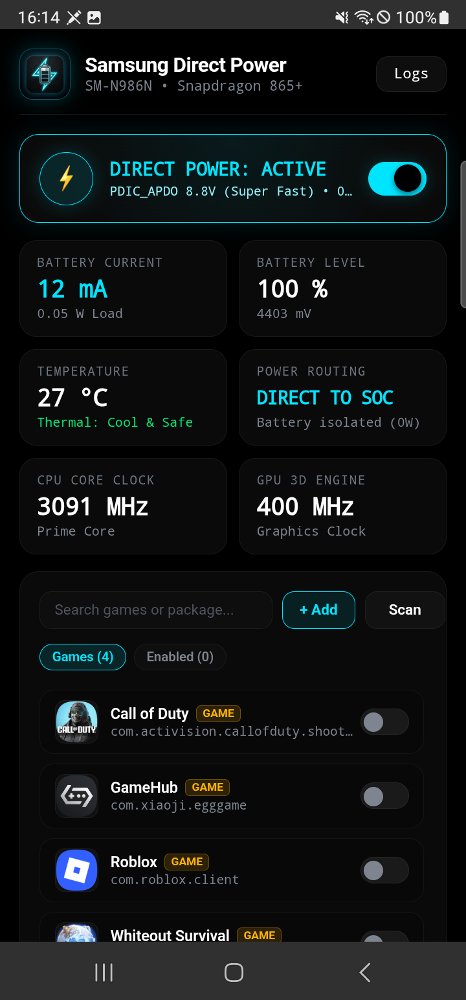
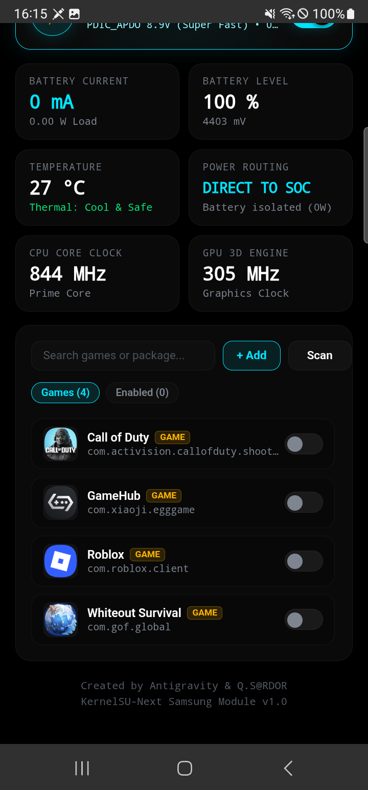
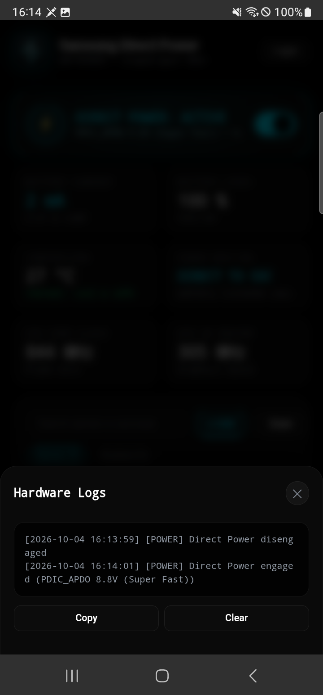

# Samsung Direct Power

> Hardware-level 0W Direct Power delivery and AMOLED governor for Samsung devices.

<p align="left">
  <a href="https://github.com/qsardor/samsung-direct-power/actions"></a>
  
  
</p>

<p align="center">
  
</p>

---

## The Problem & Empirical Discovery

Standard Android "slate mode" hacks (`batt_slate_mode=1`) turn off the charger buck converter (`MAX77705_MODE_0_ALL_OFF`), discharging internal battery cells at **-1.77A** under gaming load.

**Samsung Direct Power** activates true hardware isolation on Samsung Galaxy devices equipped with Maxim PMICs (e.g., MAX77705 / MAX77720):
- **`batt_slate_mode=0`**: Keeps the charger buck converter active (`MAX77705_MODE_4_BUCK_ON`).
- **`batt_full_capacity=50`**: Tells the kernel charger driver that battery capacity is satisfied (`SEC_BAT_CHG_MODE_CHARGING_OFF`), immediately halting charging into battery cells.
- **Outcome:** The motherboard runs directly off USB-C power with **0W net battery cell draw**, eliminating thermal throttling and battery wear during extended gaming sessions.

> [!TIP]
> For PMIC circuit mechanics, differential cache benchmarks, and the AI pair-programming anti-regression playbook, read the [Engineering & Architecture Master Report](docs/ARCHITECTURE.md).

---

## Empirical Benchmarks (SM-N986N)

Telemetry measured during continuous high-load *Call of Duty Mobile* gameplay on Samsung Galaxy Note 20 Ultra 5G (Snapdragon 865+ / SM8250 Kona):

### 1. Passive Cooling Benchmark (15 min High-Load Match)

| Metric | Direct Power Mode | Normal Fast Charging | Delta / Headroom |
| :--- | :--- | :--- | :--- |
| **Duration** | 15 min continuous | 15 min continuous | Identical match load |
| **Start / End Battery %** | **84% → 84% (0% drop)** | 84% → 85% (+1%) | **Zero cell cycle wear** |
| **Net Battery Current** | **-40.7 mA** (~0.16W avg load) | **+120.6 mA** (pulsing to +1740 mA) | **Hardware isolated** |
| **Peak Battery Temp** | **41.0 °C** (Avg: 38.9 °C) | **44.0 °C** (Avg: 41.8 °C) | **-3.0 °C Cooler** |
| **CPU Prime Core Clock** | **3091 MHz (3.09 GHz unthrottled)** | **1977 MHz (Throttled)** | **+1.11 GHz sustained clock** |
| **Adreno 650 GPU Clock** | **670 MHz (Maximum sustained)** | **441 MHz (Thermal throttling)** | **+229 MHz sustained clock** |

### 2. Active Cooler + Direct Power Benchmark (10 min eSports Match)

| Metric | Direct Power + Cooler | Battery Discharge + Cooler | Empirical Outcome |
| :--- | :--- | :--- | :--- |
| **Duration** | 10.2 min continuous | 8.5 min continuous | Competitive match load |
| **Battery Temp (Start → End)** | **25.7 °C → 25.0 °C** | 21.4 °C → 24.5 °C | **ΔT = -0.7 °C (Net Cooling)** |
| **Peak Battery Temp** | **26.0 °C** | 24.6 °C | Sub-room thermal baseline |
| **Prime Core 3.09 GHz Boost** | **45.1% sustained** | 39.1% sustained | **+6.0% time at max boost** |
| **Prime Core Sustained Clock** | **2,101 MHz average** | 1,927 MHz average | **+174 MHz clock headroom** |
| **SoC Peak Temperature** | **61.8 °C (Zero throttling)** | 57.9 °C | Zero thermal throttling |

---

## Interface & Capabilities

<p align="center">
  
  &nbsp;&nbsp;&nbsp;&nbsp;
  
</p>

- **Direct Power Routing:** Powers SoC and motherboard directly with 0W battery draw (`DIRECT TO SOC`).
- **Dynamic Kernel ADC Voltage Probe:** Real-time physical input voltage from kernel ADC (`vbyp_voltage`) and protocol (`PDIC_APDO`, `TA`, `AFC`, `USB`). Zero hardcoded values.
- **Zero-Binder Display State Watchdog:** Reads Linux DRM driver (`/sys/class/drm/card0-DSI-1/dpms`) in **0.5ms**. Immediately restores normal charging when screen locks or turns off.
- **Fast-Charging Setting Awareness:** Detects if Samsung Fast Charging is disabled in One UI system settings and displays an ambient warning with 1-tap deep link.
- **Deterministic Game Library (`AppHelper.dex`):** Native 7.4KB DEX helper querying `ApplicationInfo.CATEGORY_GAME` and `FLAG_IS_GAME`. Pre-indexed during installation with differential cache fast-path (`cmp -s`).
- **Smart Process Pre-Filtering:** Inspects `/proc` via `pidof` before window manager queries. Zero CPU overhead (0.00%) when whitelisted games are closed.
- **Dual-Control Parity:** Full dark AMOLED WebUI with KernelSU Action button, alongside a dedicated POSIX CLI and JSON API for automation.

---

## Quick Start

### Prerequisites
- Samsung device running One UI with Maxim MAX77705 or MAX77720 PMIC.
- Root access via **KernelSU**, **KernelSU-Next**, or **APatch**.

### Flash via Manager
1. Download `Samsung_Direct_Power.zip` from [Releases](https://github.com/qsardor/samsung-direct-power/releases) or [CI Artifacts](https://github.com/qsardor/samsung-direct-power/actions).
2. Open KernelSU / APatch Manager -> **Modules** -> **Install**.
3. Select the ZIP, flash, and open the module card WebUI.

### Standalone Script (Zero Dependencies)
Run [`directpower.sh`](directpower.sh) directly via Termux or ADB without installing any module or background daemons:

```bash
su -c ./directpower.sh on       # Force Direct Power (0W battery draw)
su -c ./directpower.sh off      # Restore Normal Charging
su -c ./directpower.sh toggle   # 1-Tap Toggle state
su -c ./directpower.sh status   # Hardware telemetry status (~1ms)
su -c ./directpower.sh json     # Telemetry JSON endpoint
```

---

## CLI Reference

```bash
# Hardware Power Control
directpower toggle        # 1-Tap toggle Direct Power ON / OFF
directpower on            # Force Direct Power (0W load)
directpower off           # Force Normal Fast Charging
directpower auto          # Engage Smart Governor
directpower status        # Display human-readable hardware diagnostics
directpower json          # High-speed telemetry JSON endpoint (~15ms)

# Whitelist Management
directpower getwhitelist  # List monitored package names
directpower addpkg <pkg>  # Add package to whitelist
directpower delpkg <pkg>  # Remove package from whitelist
directpower refreshapps   # Re-scan installed apps and update cached icons

# Daemon & Diagnostics
directpower start         # Start background governor daemon
directpower stop          # Stop background governor daemon
directpower restart       # Terminate stale instances and restart daemon
directpower getlogs       # Tail hardware transition logs
directpower clearlogs     # Truncate log buffer
```

---

## Project Structure

```
.
├── action.sh                 # KernelSU Manager Action Terminal toggle
├── apphelper.dex             # Native Android PackageManager DEX helper (6.3 KB)
├── direct_power_daemon.sh    # Background governor & thermal/game watchdog
├── directpower.sh            # Standalone zero-bloat CLI tool (0 dependencies)
├── module.prop               # KernelSU module manifest
├── service.sh                # Late-start boot service entrypoint
├── src/
│   └── AppHelper.java        # Source code for Android app & icon extractor
├── system/
│   └── bin/
│       └── directpower       # CLI & JSON API backend
├── webroot/
│   ├── icon.png              # Module emblem
│   ├── index.html            # Dark AMOLED WebUI dashboard (ksu.exec bridge)
│   ├── apps.json             # Cached package metadata
│   └── icons/                # Cached application PNG icons
└── docs/
    ├── ARCHITECTURE.md       # Engineering & Architecture Master Report
    └── *.png                 # Interface screenshots
```

---

## Compatibility

- **Empirically Verified:** Samsung Galaxy Note 20 Ultra 5G (`SM-N986N`, Snapdragon 865+, Maxim MAX77705 PMIC, One UI 5.1 / Android 13).
- **Target Architecture:** Universal for Samsung One UI devices equipped with Maxim PMIC battery charging subsystems (MAX77705 / MAX77720).

---

## Credits & Attribution

Created by Antigravity & Q.S@RDOR

---

## License

This project is licensed under the [MIT License](LICENSE).
